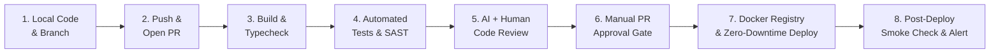

# CI/CD PIPELINE 8 BƯỚC & CHIẾN LƯỢC ZERO-DOWNTIME (`CICD_PIPELINE.md`)

> **Nguyên tắc vàng AI + CI/CD:**
> - **Môi trường `Dev / Staging`:** Cho phép AI tự động đẩy và triển khai để kiểm thử nhanh.
> - **Môi trường `Production`:** **CẤM AI TỰ ĐỘNG DEPLOY TRỰC TIẾP.** Bắt buộc phải qua cổng **Con người bấm Approve Pull Request** trên GitHub để kích hoạt đường ống CI/CD tự động.

---

## 1. Quy Trình 8 Bước CI/CD Chuẩn Doanh Nghiệp (GitHub Actions / Jenkins)

1. **Bước 1 — Code Local & Tách nhánh:** Lập trình viên hoặc AI Agent hoàn thành tính năng trên nhánh riêng.
2. **Bước 2 — Đẩy nhánh & Mở Pull Request:** Kích hoạt tự động workflow kiểm tra liên tục (CI).
3. **Bước 3 — Kiểm tra Biên dịch & Kiểu tĩnh (`Build & Typecheck`):** Chạy `tsc --noEmit`, Linter và thử đóng gói bản build.
4. **Bước 4 — Chạy Kiểm thử Tự động & Quét Bảo mật (`Test & SAST Gate`):**
   - Chạy Unit Test, Integration Test, Business Flow Test.
   - Quét lỗ hổng mã nguồn, kiểm tra lộ khóa bí mật và `npm audit`.
5. **Bước 5 — Đánh giá Mã nguồn (`Code Review`):** Kiểm tra mức độ tuân thủ `ARCHITECTURE_PLAN.md` và `DESIGN.md`.
6. **Bước 6 — Cổng Phê duyệt Thủ công (`Human Approval Gate`):** Chủ dự án / Tech Lead bấm nút **Approve & Merge** trên GitHub.
7. **Bước 7 — Đóng gói Image & Triển khai Không gián đoạn (`Zero-Downtime CD`):**
   - Build Multi-stage Docker Image (giảm 90% dung lượng), gắn tag `vX.Y.Z` đẩy lên Container Registry.
   - Máy chủ Production kéo Image mới về và khởi chạy song song trước khi ngắt container cũ.
8. **Bước 8 — Kiểm tra Sức khỏe Sau triển khai (`Healthcheck & Rollback Guard`):**
   - Gửi request kiểm tra `/healthz`. Nếu trả về `200 OK` ổn định thì hoàn tất và báo về Telegram; nếu lỗi thì tự động **Rollback** về tag phiên bản trước đó ngay lập tức.

---

## 2. Sáu Kịch Bản CI/CD Thực Tế Cần Kiểm Soát

| Kịch bản | Cơ chế kích hoạt | Hành động của Pipeline |
| :--- | :--- | :--- |
| **1. Tạo mới Pull Request (`PR Opened`)** | Tự động khi mở PR | Chạy Lint, Typecheck, Unit Test, quét bảo mật SAST. |
| **2. Gộp vào nhánh `develop` (`Merge to Dev`)** | Tự động khi merge Dev | Build và deploy thẳng lên máy chủ `Staging/Dev` để đội ngũ QA test E2E. |
| **3. Duyệt phát hành `main` (`Prod Release`)** | Con người bấm Approve + Tag `vX.Y.Z` | Chạy đủ 8 bước CI/CD và triển khai Zero-Downtime lên `Production`. |
| **4. Thay đổi Schema Database (`DB Migration`)** | Có tệp migration mới | Chạy theo mô hình **Expand & Contract** (`migrate deploy`), cấm xóa cột đang dùng. |
| **5. Khôi phục khẩn cấp (`Emergency Rollback`)** | Healthcheck lỗi hoặc lệnh Rollback | Đổi con trỏ Image về tag ổn định liền trước (`v1.0.0`) trong `< 10 giây`. |
| **6. Kiểm tra định kỳ ban đêm (`Nightly Audit`)** | Cronjob hàng đêm | Chạy Full E2E Playwright, Load Test k6 và kiểm tra tính toàn vẹn bản sao lưu DB. |

---

## 3. Ba Chiến Lược Triển Khai Không Gián Đoạn (`Zero-Downtime Strategies`)

1. **Rolling Update (Cập nhật cuốn chiếu):** Khởi động các bản sao (containers) mới từng bước; chỉ khi bản sao mới báo `Healthy` thì Nginx Gateway mới ngừng gửi request vào bản sao cũ.
2. **Blue-Green Deployment (Chuyển mạch Xanh - Lá):** Duy trì 2 môi trường song song (`Blue` đang chạy `v1.0.0`, `Green` khởi chạy mới `v1.1.0`). Kiểm tra `Green` hoàn hảo rồi đổi luồng Nginx sang `Green` trong 1ms.
3. **Canary Release (Phát hành thăm dò):** Điều hướng thử `5%` lưu lượng người dùng sang phiên bản mới, theo dõi tỷ lệ lỗi trên Grafana trong 15 phút; nếu an toàn mới nâng lên `100%`.
