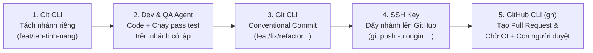

# GIT WORKFLOW 4 CÔNG CỤ AN TOÀN TOKEN (`GIT_WORKFLOW.md`)

> **Vai trò của tệp này:** Hướng dẫn AI Agent và đội ngũ phát triển phối hợp **4 công cụ Git** (`Git CLI`, `SSH Key`, `GitHub CLI (gh)`, `GitHub MCP`) đúng ngữ cảnh để **không bao giờ ghi đè mất code của nhóm** và **không đốt hàng triệu token vô ích**.

---

## 1. Ma Trận Phân Vai 4 Công Cụ Git

| Công cụ | Chi phí Token nền | Khi nào sử dụng? | Điều cấm kỵ |
| :--- | :---: | :--- | :--- |
| **1. `Git CLI` (`git`)** | `~0 Token` | Tách nhánh cục bộ (`checkout -b`), kiểm tra thay đổi (`status`, `diff`), lưu phiên bản (`add`, `commit`), gắn thẻ (`tag`). | Cấm commit thẳng vào nhánh `main`/`production`; cấm `push --force`. |
| **2. `SSH Key` (`git@github.com:...`)** | `~0 Token` | Xác thực mã hóa bất đối xứng (Public/Private Key) để `clone`, `fetch`, `pull`, `push` an toàn cho toàn bộ các repo trong Monorepo. | Cấm nhúng Personal Access Token (PAT) dạng văn bản thuần vào URL remote. |
| **3. `GitHub CLI` (`gh`)** | `Rất thấp` | Tạo Issue (`gh issue create`), tạo Pull Request (`gh pr create`), kiểm tra trạng thái CI (`gh pr checks`), xem bình luận review. | Không tự ý chạy `gh pr merge` vào nhánh Production khi chưa có lệnh duyệt của con người. |
| **4. `GitHub MCP`** | `Rất cao (Nặng)` | Chỉ bật tạm thời khi cần quản trị cấu hình kho mã nguồn phức tạp trên đám mây mà `gh` CLI không hỗ trợ sẵn. | Không bật thường trực trong mọi phiên code để tránh ngốn cửa sổ ngữ cảnh. |

---

## 2. Quy Trình 5 Bước Làm Việc Với Git Dành Cho AI Agent



### Bước 1: Cô lập nhánh theo từng tính năng (`Branch Isolation`)
Trước khi sửa bất kỳ dòng code nào, AI bắt buộc tách nhánh mới từ nhánh phát triển:
```bash
git checkout -b feat/feat-007-payment-webhook
```

### Bước 2: Viết code & Chạy kiểm thử cục bộ trên nhánh riêng
Mọi thay đổi và bài kiểm thử đều diễn ra trên nhánh vừa tách, đảm bảo nhánh `main` luôn sạch và ổn định 100%.

### Bước 3: Ghi nhận Commit theo chuẩn `Conventional Commits`
```bash
git add .
git commit -m "feat(payment): verify HMAC signature and enforce Redis idempotency lock"
```
- Các tiền tố chuẩn: `feat:` (tính năng mới), `fix:` (sửa lỗi), `refactor:` (tái cấu trúc), `test:` (thêm kiểm thử), `docs:` (cập nhật tài liệu `.md`), `chore:` (cấu hình hạ tầng/build).

### Bước 4: Đẩy nhánh lên đám mây qua giao thức `SSH`
```bash
git push -u origin feat/feat-007-payment-webhook
```

### Bước 5: Tạo Pull Request & Kiểm tra CI bằng `GitHub CLI (gh)`
```bash
gh pr create --title "feat(payment): implement webhook IPN idempotency" --body "Closes #7. Verified against BUSINESS_FLOW.md and SPEC.md."
gh pr checks
```

---

## 3. Quy Trình Làm Việc Nhóm Đa Agent (`Multi-Agent Team Workflow`)
- **Worker Agents (Frontend Agent / Backend Agent / Infra Agent):** Mỗi Agent làm việc trên một nhánh tính năng độc lập hoặc một phân khu riêng.
- **QA Agent:** Kiểm tra tự động trên nhánh PR.
- **Leader Agent / Human Reviewer:** Kiểm tra xung đột, đối chiếu với `ARCHITECTURE_PLAN.md` và bấm **Approve & Merge** trên GitHub.
