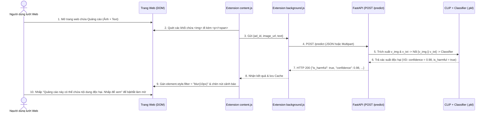

# SYSTEM ARCHITECTURE PLAN — Hồ Sơ Kiến Trúc Hệ Thống (`ARCHITECTURE_PLAN.md`)

> **Đề tài:** Xây dựng mô hình đa phương thức nhằm phát hiện quảng cáo số gây hại dựa trên văn bản – hình ảnh.
> - Đồng bộ tự động theo `.agents/rules/architecture-signature.md`.
> - Tài liệu này đồng thời là tư liệu cốt lõi cho **Giai đoạn 5 (Tuần 8): Viết báo cáo & Bảo vệ đồ án**.

---

## 1. Tổng Quan Dự Án & Mục Tiêu Nghiệp Vụ
- **Bài toán thực tế:** Quảng cáo số độc hại (cờ bạc, tín dụng đen, thuốc giả mạo, meme kích động thù địch) thường lách bộ lọc từ khóa truyền thống bằng cách **chèn chữ lên hình ảnh** hoặc kết hợp hình ảnh ẩn dụ với câu chữ kích thích.
- **Giải pháp:** Kết hợp mô hình **Transfer Learning đa phương thức OpenAI CLIP** (`openai/clip-vit-base-patch32`) để trích xuất đồng thời vector đặc trưng Hình ảnh ($v_{\text{img}}$) và Văn bản ($v_{\text{txt}}$), nối thành vector hợp nhất $[v_{\text{img}} \Vert v_{\text{txt}}]$, phân loại qua **Classifier (`MLP` / `LightGBM` / `SVM`)**, cung cấp qua **FastAPI (`POST /predict`)** và tự động làm mờ quảng cáo trên trình duyệt bằng **Chrome/Edge Extension Manifest V3**.

## 2. Bảng Tổng Hợp Tech Stack Thực Tế

| Phân tầng | Công nghệ sử dụng | Vai trò trong hệ thống |
| :--- | :--- | :--- |
| **Giai đoạn 1 (Data & EDA)** | Python, `Pandas`, `OpenCV` (`cv2`) | Kiểm tra số lượng ảnh, kích thước ảnh, phân phối độ dài text và độ lệch nhãn (`sample_ads_dataset.json` / Hateful Memes). |
| **Giai đoạn 2 (Transfer Learning)** | HuggingFace `transformers` (`CLIPModel`, `CLIPProcessor`), `scikit-learn` (`MLPClassifier`), `LightGBM` | Trích xuất vector đặc trưng Ảnh + Text, nối (`Concatenate`) xuất `features.csv`, huấn luyện Classifier lưu `.pkl`. |
| **Giai đoạn 3 (Backend API & Cloud)** | `FastAPI` + `Uvicorn` + Built-in `ThreadingHTTPServer` Fallback, `Docker` | Phục vụ `POST /predict`, `POST /predict/batch`, `GET /healthz`, `GET /demo`; sẵn sàng host trên HuggingFace Spaces / Render. |
| **Giai đoạn 4 (Frontend Extension)** | Chrome / Edge Extension **Manifest V3** (`manifest.json`, `content.js`, `background.js`, `popup/`) | Quét DOM (`` + `<p>`/`<span>`), gọi API, làm mờ `filter: blur(10px)` và gắn nút cảnh báo tương tác. |
| **Observability & QA** | Structured 13-Field JSON Logger (`src/lib/logger.py`), `unittest` / `pytest` | Ghi log truy vết chuẩn 13 trường và kiểm thử tự động 15 kịch bản. |

## 3. Cấu Trúc Cây Thư Mục (`Unified 3-Tier Architecture`)
```text
D:\Projects\DACNTT/
├── AGENTS.md & CLAUDE.md                        # Bản đồ điều hướng trung tâm cho AI Agent
├── Dockerfile & requirements.txt                # Đóng gói Multi-stage cho HuggingFace Spaces / Render
├── docs/                                        # Kho tài liệu sống 6 phân khu
├── src/
│   ├── app/                                     # TẦNG 3: Orchestrator / Router (< 80 dòng)
│   │   ├── main.py                              # FastAPI + Standard HTTP Entrypoint
│   │   └── demo/index.html                      # Trang mạng xã hội & báo điện tử giả lập để test & quay Demo
│   ├── features/                                # TẦNG 2: Feature & Domain Modules (Giai đoạn 1, 2, 4)
│   │   ├── dataset_eda/preprocess_eda.py        # Giai đoạn 1: Tiền xử lý & EDA
│   │   ├── clip_extractor/extract_features.py   # Giai đoạn 2 (Tuần 2): Trích xuất & nối vector CLIP -> features.csv
│   │   ├── clip_extractor/kaggle_notebook_pipeline.py # Script chuẩn chạy trên Kaggle GPU
│   │   ├── classifier/train_classifier.py       # Giai đoạn 2 (Tuần 3): Huấn luyện Classifier -> .pkl
│   │   └── extension/                           # Giai đoạn 4 (Tuần 6-7): Chrome/Edge Extension Manifest V3
│   │       ├── manifest.json
│   │       ├── background.js
│   │       ├── content.js
│   │       ├── content.css
│   │       └── popup/ (popup.html, popup.css, popup.js)
│   ├── server/                                  # TẦNG BACKEND & INFERENCE (Giai đoạn 3)
│   │   ├── schemas.py                           # DTO Validation
│   │   ├── inference_service.py                 # Kết hợp CLIP Extractor + Classifier + Chống SSRF
│   │   ├── http_gateway.py                      # Controller xử lý /predict, /predict/batch, /healthz
│   │   └── models/harmful_ad_classifier.pkl     # File trọng số mô hình đã huấn luyện
│   ├── lib/                                     # Cấu hình Fail-fast (config.py) & Log 13 trường (logger.py)
│   └── mocks/                                   # Dữ liệu mẫu, eda_report.json, features.csv, bootstrap weights
└── tests/                                       # Kiểm thử tự động (unit/, integration/, e2e/)
```

## 4. Sơ Đồ Kiến Trúc Hệ Thống Tổng Thể (Dùng Cho Báo Cáo Giai Đoạn 5)

```mermaid
flowchart LR
    subgraph Client ["Trình Duyệt Người Dùng (Chrome / Edge)"]
        WebDOM["Trang Web (Facebook / Báo điện tử / Trang Demo)<br/>Thẻ &lt;img&gt; + &lt;p&gt;/&lt;span&gt;"]
        ContentJS["content.js<br/>Quét DOM &amp; Làm mờ blur(10px)"]
        BgSW["background.js<br/>Service Worker Proxy &amp; Cache"]
        PopupUI["popup.html<br/>4 Trạng thái UI &amp; Thống kê"]
    end

    subgraph CloudAPI ["Backend API (Localhost / HuggingFace Spaces / Render)"]
        Gateway["FastAPI / HTTP Gateway<br/>POST /predict"]
        CLIP["OpenAI CLIP Encoder<br/>Vision Embedding + Text Embedding"]
        Concat["Concatenation Layer<br/>v_fused = [v_img || v_txt]"]
        Clf["Trained Classifier (.pkl)<br/>MLP / LightGBM / SVM"]
    end

    WebDOM -->|"1. Trích xuất {image_url, text}"| ContentJS
    ContentJS -->|"2. Message ADSHIELD_PREDICT"| BgSW
    BgSW -->|"3. HTTP POST /predict"| Gateway
    Gateway --> CLIP --> Concat --> Clf
    Clf -->|"4. JSON {is_harmful, confidence}"| Gateway
    Gateway -->|"5. Trả kết quả phân loại"| BgSW
    BgSW --> ContentJS
    ContentJS -->|"6. Nếu is_harmful=true:<br/>filter: blur(10px) + Nút cảnh báo"| WebDOM
    PopupUI <-->|"Xem thống kê &amp; Đổi API URL"| BgSW
```



## 5. Hành Trình Chi Tiết Của Một Request (`Request Sequence Diagram`)



## 6. Lý Do Chọn Transfer Learning (Phân Tích Dành Cho Bảo Vệ Đồ Án Giai Đoạn 5)
1. **Tối ưu chi phí & thời gian tính toán:** Huấn luyện một mô hình đa phương thức từ đầu (From Scratch) đòi hỏi hàng triệu cặp ảnh–chữ và cụm GPU đắt đỏ. Bằng cách đóng băng (Freeze) **OpenAI CLIP** (`openai/clip-vit-base-patch32`) làm bộ trích xuất đặc trưng và chỉ huấn luyện tầng phân loại (`Classifier`) trên `features.csv`, thời gian huấn luyện giảm từ nhiều ngày xuống chỉ còn **vài giây đến vài phút** trên CPU/Kaggle miễn phí.
2. **Hiểu ngữ cảnh chéo giữa Ảnh và Chữ:** Không gian vector của CLIP đặt hình ảnh và văn bản vào cùng một không gian ngữ nghĩa, giúp phát hiện hiệu quả các quảng cáo lách luật hoặc meme châm biếm độc hại.
3. **Suy luận nhẹ khi triển khai:** Phản hồi trung bình `< 20ms` với bộ trích xuất rút gọn và `< 150ms` với CLIP đầy đủ, hoàn toàn phù hợp để làm mờ quảng cáo theo thời gian thực khi người dùng cuộn trang.

## 27. Báo Cáo Điểm Khuyết & Hạng Mục Cần Lưu Ý (`[NOT_FOUND]` Audit)
- `[NOT_FOUND - Môi trường Local hiện tại]`: Máy cục bộ đang chạy Python 3.14 thuần chưa cài đặt gói `torch` và `transformers` nặng ~2GB; hệ thống đang tự động sử dụng **Lightweight Multimodal 64D Engine + Trained Weights** để chạy tức thì. Khi đưa lên Kaggle hoặc HuggingFace Spaces (qua `Dockerfile` / `requirements.txt`), hệ thống tự động nạp `openai/clip-vit-base-patch32` đầy đủ.
- `[NOT_FOUND - Giai đoạn 5]`: Video quay màn hình Demo 3–5 phút và file trình chiếu PowerPoint sẽ do nhóm thực hiện trên nền trang `/demo` đã dựng sẵn.
